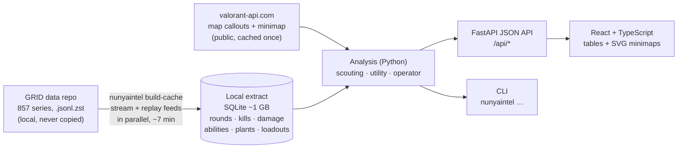

# NunyaIntel

**VALORANT opponent scouting from pro match data: how a team wins rounds, where it sets up its utility, and how it plays the Operator.**

An individual entry for the **Cloud9 × JetBrains: Sky's The Limit Hackathon 2026, Category 1: VALORANT Tactical Scouting, Utility Placement & Operator Profiler.** It runs locally on the hackathon's GRID data: 857 series, 2,078 maps, 42,490 rounds, 160 teams (VCT Americas, Masters and Game Changers, Jan 2025 – Sep 2026).

NunyaIntel answers three questions a coach asks before playing a team:

| Question | NunyaIntel shows |
|---|---|
| **How do they win and lose rounds?** | Map and side win rates, how rounds end, pistol and economy patterns, which sites they hit and hold, default setups, where opening duels happen |
| **Where and when do they use utility?** | Every ability by timing (set up during the buy phase or used mid-round), the **lineups** they repeat (same spot, same aim, across matches) drawn on the minimap, and how well each one works |
| **How do they play the Operator?** | Who buys it and when (by team economy), opening-duel success with vs. without it, and the **angles** they hold, drawn on the minimap |

## What it finds: Cloud9 (VCT Americas 2025)

These are examples from 45 maps / 961 rounds. Sample sizes are in brackets; treat small ones as leads, not verdicts. **Every number here is recomputed from the data by `nunyaintel verify-claims`**, with results in [`docs/claims.md`](docs/claims.md).

- **Anti-eco is a weakness.** On a full buy against an eco or semi-eco, Cloud9 lost **30% of rounds (15 of 50)**. The league average is **17.5% (888 of 5,067)**, which makes it the **worst of the 55 teams** with 30+ such rounds.
- **Pistol rounds are league-average.** After winning a pistol they won the next round **85% of the time (40 of 47)**, which sounds strong, but the league converts **86.2% (3,546 of 4,114)**. That's why NunyaIntel compares with the league, not with 50%.
- **Lotus has a clear attack plan and a weak spot on defense.** On attack they play **A**: 35% of rounds, won **76% (42 of 55)** after planting there. In **23% of attack rounds they never plant, and win 1 of 35**. On defense, **C** is hit most and is their weakest hold: **33% (16 of 49)**.
- **The Operator is a role, not a crutch.** OXY holds an Op in **10% of rounds (97 of 961)**, almost only on full buys (94 of the 97), and wins **67% of his opening duels with it (20 of 30)**.

> **Data coverage:** the dataset has no VCT (main-team) matches in 2026; all 2026 data is Game Changers. Cloud9's VCT data runs Jan–Aug 2025. Cloud9 GC (Game Changers) has 9 series from Jul–Sep 2026.

## Quickstart

You need **Python 3.14+**, **Node.js 22.12+** and **git**, plus ~3 GB of disk for the data and ~1 GB for the extract. This path was rehearsed on a fresh clone.

```powershell
# 1. Get the code and, NEXT TO it (not inside), the hackathon's GRID data (~1.4 GB)
git clone https://github.com/Bryanspirit/NunyaIntel.git
git clone https://github.com/cloud9esports/stl-hackathon-2026-grid-starter.git
cd NunyaIntel

# 2. Install
py -3.14 -m venv .venv                    # macOS/Linux: python3.14 -m venv .venv
.venv\Scripts\python -m pip install -e .  # macOS/Linux: .venv/bin/...

# 3. Check the setup: every problem comes with the command that fixes it
.venv\Scripts\nunyaintel doctor

# 4. Build the local extract once (~7 min, ~1 GB; reads the data in place)
.venv\Scripts\nunyaintel build-cache

# 5. Build the web app and open it: http://127.0.0.1:4811
.venv\Scripts\nunyaintel serve --build --open
```

- Data elsewhere? Set `STL_DATA_DIR` to the data repo's path.
- Saving disk with a sparse checkout of the data? Include **`meta`**: `git sparse-checkout set val val-ability-supplements meta`. (The data README's example leaves it out, and NunyaIntel needs it.)
- Port 4811 taken? Use `nunyaintel serve --port 4821`.

### Or run it with Docker

After step 4 above (the extract has to exist in `data/cache`), with Docker Desktop running:

```powershell
docker compose up -d --build     # then open http://127.0.0.1:4811
docker compose logs -f           # watch it start (the first start copies the extract, ~1 min)
docker compose down              # stop it (add -v to also delete Docker's copy of the extract)
```

- **The image holds code only.** The licensed data and the extract are mounted at run time, never built into the image, so sharing the image can't leak them.
- **Fast on Windows and macOS:** on first start (and whenever you rebuild the extract), `docker-entrypoint.sh` copies `data/cache` into a Docker volume. Reading the 1.1 GB extract straight from a Windows folder was 10–20× slower (a game plan took 56 s instead of 3 s).
- **Local only:** the port is published on `127.0.0.1`, as the data licence allows local use, not a public server.

## A tour

Pick a team (the **Cloud9** / **Cloud9 GC** buttons are shortcuts), a map and optionally a side. The selection lives in the URL, e.g. `/?team=79&map=lotus&tab=utility`, so any view can be bookmarked or shared.

| Tab | What you see |
|---|---|
| **Key findings** (landing view) | The team's most unusual numbers vs. the whole league, ranked by a z-score (how far from the league, given the sample size), each with counts, league rate and rank. Plus site findings for the selected (or most-played) map. **Details →** opens the evidence |
| **Scouting** | Headline numbers (side win %, pistol conversion, anti-eco losses, eco upsets) · per-map record · how rounds end · a buy-vs-buy win-rate heat grid. With a map: **every spike plant on the minimap**, site tables (where they plant / what they hold), default setups per player, opening-duel areas |
| **Operator** | Who uses the Op · Op rate by team economy · opening duels with vs. without it. With a map: **angles drawn as arrows** (shooter area → target area) |
| **Replay** (2D / **3D**) | In **3D** the map is a model with raised walls (drawn from the data): orbit by dragging, ＋/－ to zoom, an auto-rotating broadcast camera, kill tracers arcing through the air and spike plants as light beams. Press ▶ and watch a team's rounds unfold on the minimap, second by second from the end of the buy phase: kills (with a tracer from shooter to victim), deaths, utility and plants. **Live** view (events flash and fade) or **Build-up** (habits accumulate), all rounds overlaid or one specific round, a draggable timeline with a kills/deaths density strip (click to jump), speeds 1–8×, layer toggles, hover for details, Space and ← → on the keyboard |
| **Predict** | **Who wins a map?** Elo ratings (the chess system) give a map-win probability vs. any opponent, shown with the model's test results (66.8% right on 503 unseen maps vs. 50% for a coin flip, with a calibration table) and warnings for stale ratings or teams never linked by any chain of matches. **What will they buy next round?** For a chosen situation (last buy, won or lost, loss streak), the team's usual next buy vs. the league (81.8% right vs. 73.6% for always guessing full-buy; ecos caught 87%) |
| **Utility** | Every ability: casts per round, % set up during the buy phase, median timing. **Lineups drawn as aim arrows** and ranked by effectiveness. Hover a row to highlight its arrow |

Everything is also available on the command line:

```powershell
nunyaintel findings --team Cloud9 [--map lotus]
nunyaintel scout    --team Cloud9 [--map lotus] [--since 2025-06-01]
nunyaintel operator --team Cloud9 [--economy | --duels | --map pearl --angles]
nunyaintel utility  --team Cloud9 --map lotus [--side defender] [--lineups --score]
```

*Screenshots: coming with the submission kit (task K4).*

## How it works



1. **Extract:** each match feed is replayed once, in parallel. Every event carries a full match snapshot, so feeds are 50–200× larger uncompressed. The replay undoes reversed events and drops abandoned maps, then keeps only compact rows. It's verified against the data's own index: all 2,078 maps are present, and round winners add up to every map's final score.
2. **Analysis:** plain Python + SQL over the extract. It runs in seconds, with one module per question.
3. **Presentation:** a FastAPI server returns JSON (with minimap coordinates already computed), and a React app draws tables and SVG overlays on the minimap. `nunyaintel serve` runs both from one process.
4. **Speed:** every view answers in under 1 s from scratch (the slowest, lineup scoring, takes 0.75 s) and in ~2 ms once cached. The extract is read-only, so responses are cached per URL and invalidated when it's rebuilt. `serve` pre-loads the Cloud9 and Cloud9 GC views in the background (~5 s).

## Methods (short version)

- **Economy:** each team-round is classified by the team's total loadout value at the end of the buy phase: eco < 5k, semi-eco < 10k, semi-buy < 20k, full-buy ≥ 20k, and rounds 1 and 13 are pistol. These are the usual eco / half-buy / full-buy split analysts use, with cutoffs placed at the dips in our data's distribution of team loadouts.
- **Utility timing** is measured from the **end of the buy phase**, so a negative time = set up before the round starts (e.g. Cypher Trapwire −20 s).
- **Lineups:** **DBSCAN** clustering on cast position (±1.5 m) and aim direction (±10°), per team / map / side / agent / ability, kept only if repeated in ≥ 2 matches. Cast positions come from the GRID ability supplement.
- **Lineup score:** the round win rate when the lineup was used vs. the team's usual rate on that map and side, **shrunk toward the usual rate** (10 imaginary average rounds) so that a 3-for-3 lineup can't outrank strong evidence. Also reported: ability damage per cast and team kills/deaths in the 10 s after the cast. It's correlation, not causation.
- **Sites and areas:** positions are named by the nearest map callout from valorant-api.com. Verified: plants sit a median 3–18 m from their site's callout, sites are 43–121 m apart (so no plant's site is ambiguous), and site callouts land on the minimap's site areas. 26 plants (0.09%, all on Bind) were recorded 67–170 m from any site. A spike can only be planted on a site, so these are bad position records and are labelled "unknown" (cut at 50 m, in the gap after the farthest real plant at 46 m).
- **Default setups:** each player's first known position in the first 20 s of the round. Players are only "seen" when they act, so coverage is shown next to each one.
- **Operator angles:** each Operator hit has a shooter and a target position. Hits are grouped by named area (shooter area → target area); `--precise` clusters exact spots instead. Hits over 100 m are dropped as bad positions.

- **Key findings:** each metric is compared with the league rate p using z = (team rate − p) ÷ √(p(1−p)/n), so findings are ranked by how unusual *and* how well-supported they are. |z| < 1 is shown as a "tendency" (normal variation). League baselines (~40 s) are cached per extract build in `data/cache/league_baselines.json`.

- **Predictions** are tested the way a coach would use them: trained on earlier matches, scored on the latest 30% they never saw, against a baseline. Predicting a team's *attack site* from its history was tested too, and dropped: it did no better than the map's league-wide habits (`docs/predictive-feasibility.md`).

## Data, license and caveats

- The **GRID data is licensed for this hackathon only**. It is read in place from a separate clone and never copied, committed or published: `.gitignore` excludes it, and a pre-commit hook (`scripts/check_no_data.py`) blocks it. The server binds to `127.0.0.1` only. Charts, screenshots and aggregate numbers are fine to share.
- Low-rate positions: VCT Americas 2025 movement is sampled at 1 Hz (others at 5 Hz), so cast positions there can be a few metres off.
- Map-targeted abilities (Omen and Brimstone smokes, Astra) are aimed on the minimap, so their arrows show where the caster faced, not where the smoke landed.
- "Spike defused" includes rounds where the defenders killed every attacker after the plant: they still have to defuse.
- About 3.7% of kills are ability kills with no weapon recorded. They don't affect Operator stats.

## Project structure

```
src/nunyaintel/
  data/        grid.py (stream the data repo) · extract.py (build/read the SQLite extract)
  scouting/    team_rounds · overview (T1) · economy_report (T2) · sites (T3) · report
  utility/     placement (U1) · lineups (U2, DBSCAN) · effectiveness (U3)
  operator_profiler/  profiler (O1, O2) · angles (O3)
  api/         FastAPI app (JSON for the web app)
  maps.py · economy.py · doctor.py · __main__.py (CLI)
web/           React + TypeScript (Vite): pages, <Minimap>, typed API client
tests/         pytest on synthetic data only (the licensed data never appears in tests)
docs/          learning-log.md: what was built at each step and why
```

## Development

```powershell
.venv\Scripts\python -m pip install -e ".[dev]"
.venv\Scripts\python -m pytest            # synthetic data only
.venv\Scripts\python -m ruff check .
cd web; npm run build                     # type-check + bundle
```

**Frontend with live reload:** run `nunyaintel serve` (API on :4811) and `cd web; npm run dev` (http://127.0.0.1:4810, forwards `/api/*` to :4811).

Install the data guard as a git pre-commit hook:

```sh
printf '#!/bin/sh\nexec .venv/Scripts/python.exe scripts/check_no_data.py\n' > .git/hooks/pre-commit
```

## How it was built

Developed in **PyCharm** with AI coding agents. `TASKS.md` is the shared task board, recording who did what and when, and `.junie/guidelines.md` holds the project rules every agent follows. Most of the code so far was written with **Claude Code**; **Junie** (JetBrains' agent) takes the frontend polish and CI tasks. `docs/learning-log.md` records each step: what was built, the key ideas, and the bugs found along the way.

**Built with:** Python 3.14 (stdlib `compression.zstd`, `sqlite3`, `concurrent.futures`) · FastAPI · Uvicorn · React 19 · TypeScript · Vite · SVG · pytest · Ruff · GRID data · valorant-api.com map data.

## License

The code license is to be decided (task P7). The GRID data is not covered by this repo's license. It belongs to its owners and is used under the hackathon's data license.
